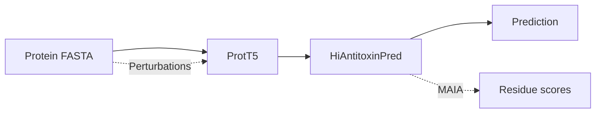

# HiAntitoxinPred

HiAntitoxinPred predicts antitoxin proteins from FASTA sequences using ProtT5 representations and provides residue-level interpretation with MAIA.



**Model downloads:** [Zenodo v3.0](https://doi.org/10.5281/zenodo.23755956). The commands below download and install the required models automatically. See [offline installation](docs/installation.md#environment-and-assets) for local files.

## Installation

Linux, Python 3.9 and an NVIDIA GPU:

```bash
git clone https://github.com/chelseawhu/HiAntitoxinPred.git
cd HiAntitoxinPred
python3.9 -m venv .venv
source .venv/bin/activate
python -m pip install --upgrade pip
python -m pip install torch==2.5.1 --index-url https://download.pytorch.org/whl/cu124
python -m pip install .
```

[CPU installation and other CUDA builds](docs/installation.md).

## Prediction

The example uses **P9WJ87 / AT6247**, the main-text case.

```bash
hiantitoxinpred download --assets best
hiantitoxinpred download --assets encoder
hiantitoxinpred predict --fasta examples/AT6247.fasta --device cuda:0 --output results/predictions.csv
```

The CSV contains protein scores and labels (`1`: antitoxin, `0`: negative), using a threshold of 0.5. Sequences longer than 200 residues are truncated before encoding. [Example output](examples/expected/AT6247_prediction.csv).

## MAIA

```bash
hiantitoxinpred maia --fasta examples/AT6247.fasta --device cuda:0 --output results/maia
```

Per-residue scores are saved to `protein_0001/residue_scores.csv`. Positive scores indicate that perturbation lowered the antitoxin score. [MAIA guide](docs/maia.md) · [Example outputs](examples/expected/README.md).

## Training

```bash
hiantitoxinpred download --assets encoder
hiantitoxinpred extract-features --device cuda:0
hiantitoxinpred train --config configs/main.json --seed 42 --device cuda:0 --output runs/seed42
```

The fixed Main sequences and splits are included in `data/main/`. Extract features once, then reuse `assets/main_features/` for all training seeds and Main evaluations. Precomputed Main features are not a download requirement. Use `--device cpu` for CPU extraction, which is slower and uses FP32 encoding.

## Evaluation

Generate Main features using the commands above before either evaluation route.

```bash
# Evaluate your trained checkpoint:
hiantitoxinpred evaluate --checkpoint runs/seed42/L.pt --split test --device cuda:0 --output results/seed42

# Or evaluate a supplied model:
hiantitoxinpred download --assets main-models
hiantitoxinpred evaluate --models assets/models --seed 42 --split test --device cuda:0 --output results/reference_seed42
```

Repeat training/evaluation with seeds 43–46 for five runs. Regenerated features can differ numerically across devices, so exact agreement with archived metrics is not guaranteed. See [Main reproduction](docs/reproduce_main.md) for the dataset and training settings.

## Citation and license

[Citation](CITATION.cff) · [MIT license](LICENSE) · [Data and model sources](docs/data_provenance.md).
