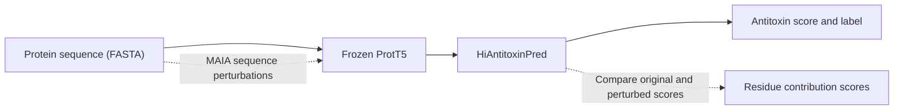

# HiAntitoxinPred

**Antitoxin prediction and residue-level interpretation from protein sequences.**

HiAntitoxinPred combines frozen ProtT5 representations with local and global sequence modeling to classify proteins as antitoxins. MAIA identifies residues whose perturbation changes the prediction score. The repository includes pretrained models, Main training and evaluation, and MAIA inference.



**Model downloads:** Zenodo links are being prepared. Until they are available, use local model files through the offline download option below.

## Quick start

The commands below use Linux, Python 3.9 and an NVIDIA GPU. CPU setup is described in [installation](docs/installation.md).

### 1. Install

```bash
git clone https://github.com/chelseawhu/HiAntitoxinPred.git
cd HiAntitoxinPred
python3.9 -m venv .venv
source .venv/bin/activate
python -m pip install --upgrade pip
python -m pip install torch==2.5.1 --index-url https://download.pytorch.org/whl/cu124
python -m pip install .
```

For another CUDA build, follow the [PyTorch 2.5.1 installation options](https://pytorch.org/get-started/previous-versions/#v251).

### 2. Download and predict

The example is **P9WJ87 / AT6247**, the 82-residue case used in the main text.

```bash
hiantitoxinpred download --assets best
hiantitoxinpred download --assets encoder
hiantitoxinpred predict --fasta examples/AT6247.fasta --device cuda:0 --output results/AT6247_predictions.csv
```

`best_model.pt` is the seed42/epoch159 model, selected by the lowest validation loss among the five Main runs. The encoder downloads from the official ProtT5 repository. Sequences longer than 200 residues are truncated before encoding.

An actual GPU example output is included in [examples/expected/AT6247_prediction.csv](examples/expected/AT6247_prediction.csv):

```csv
id,original_length,input_length,truncated,raw_logit,probability,prediction
AT6247,82,82,False,30.244108200073242,1.0,1
```

`prediction=1` denotes an antitoxin prediction; `prediction=0` denotes a negative prediction. The probability threshold is 0.5. `raw_logit` is the score before sigmoid; `truncated` indicates whether the input was shortened. Scores may differ slightly across computing environments.

### 3. Explain the same protein with MAIA

```bash
hiantitoxinpred maia --fasta examples/AT6247.fasta --device cuda:0 --output results/AT6247_maia
```

MAIA runs 10 perturbations for each of the 63 complete 20-residue windows in this example. Its output is:

```text
results/AT6247_maia/
├── COMPLETE.json
└── protein_0001/
    ├── residue_scores.csv
    ├── window_scores.csv
    ├── raw_scores.json
    ├── metadata.json
    └── progress.json
```

| File | What to read |
|---|---|
| `residue_scores.csv` | One row per residue: position, amino acid, signed contribution, absolute sensitivity and window coverage |
| `window_scores.csv` | Coordinates and mean logit change for each perturbed window |
| `raw_scores.json` | Original/perturbed scores and mutation records |
| `metadata.json` | Input identifier, model and calculation settings |

Positive signed contributions indicate that perturbation lowered the antitoxin score. See the [actual AT6247 CSV examples](examples/expected/README.md) and [MAIA guide](docs/maia.md) for interpretation and paper-case settings. MAIA takes longer than prediction because perturbed sequences are encoded separately.

For CPU use, replace `--device cuda:0` with `--device cpu` after the [CPU installation](docs/installation.md#cpu-installation).

To install local model/data files, add `--offline-dir /path/to/zenodo_assets` to download commands. The encoder continues to download from its official source.

## Reproduce Main

```bash
hiantitoxinpred download --assets main-models
hiantitoxinpred download --assets main-features
# Evaluate a supplied model:
hiantitoxinpred evaluate --models assets/models --seed 42 --split test --device cuda:0 --output results/reference_seed42
# Train and evaluate a new model:
hiantitoxinpred train --config configs/main.json --seed 42 --device cuda:0 --output runs/seed42
hiantitoxinpred evaluate --checkpoint runs/seed42/L.pt --split test --device cuda:0 --output results/retrained_seed42
```

Repeat with seeds 43–46 for five runs. Training selects the lowest validation-loss checkpoint; test evaluation is a separate command. The [Main guide](docs/reproduce_main.md) describes the fixed split, recipe and reference metrics. Fresh training uses the same recipe; scores can vary with initialization and environment. See [numerical details](docs/numerical_behavior.md).

## Repository layout

- `src/hiantitoxinpred/`: model, training, prediction and MAIA.
- `configs/`: Main and MAIA settings.
- `data/main/`: sequences, labels and fixed splits.
- `pretrained/manifest.json`: downloadable assets.
- `examples/`: case sequences and actual output examples.
- `results/reference/`: five-model reference metrics.
- `docs/`: installation, reproduction and model documentation.
- `tests/` and `tools/`: tests and optional reference checks.

## Tests and citation

```bash
python -m unittest discover -s tests -v
```

See [CITATION.cff](CITATION.cff), the [model card](docs/model_card.md) and [data sources](docs/data_provenance.md). Code uses the [MIT license](LICENSE); third-party data and ProtT5 retain their original terms.
